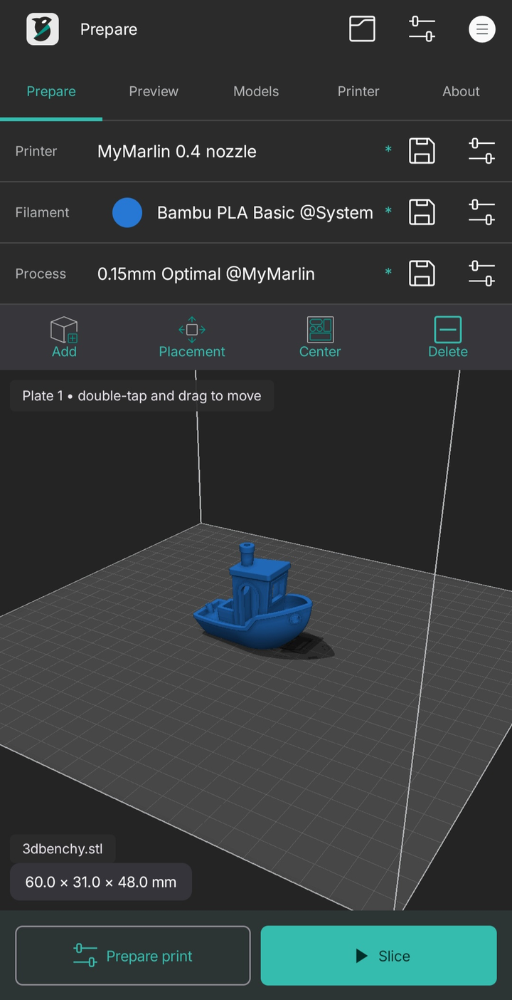
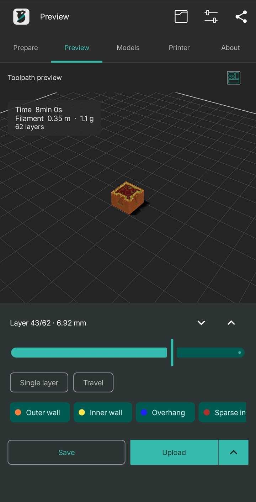

[English](README.md) · [Русский](README.ru.md)

<p align="center">
  
</p>

# OrcaMicro

A 3D-print slicer for Android that runs [OrcaSlicer](https://github.com/SoftFever/OrcaSlicer)'s
slicing engine on the phone itself. Prepare a model, slice it on the phone, check the layers, then
save the G-code or send it to a Klipper or OctoPrint printer.

**Slicing works fully offline.** The network is only used for the model catalogs, app updates and
printer connections, and only when you use them.

**Android 14+ · 64-bit ARM · OpenGL ES 3 · OrcaSlicer 2.5.1 engine · Beta**

[Download APK](https://github.com/whoxllm/OrcaMicro/releases/latest) · [User guide (RU)](docs/USAGE.md) · [Import profiles (RU)](docs/PROFILES.md) · [Build instructions (RU)](docs/BUILDING.md)

<p align="center">
  
  
</p>
<p align="center">
  
  
</p>

## What it does

- **Slicing on the phone:** OrcaSlicer 2.5.1's own engine. Walls, infill, shells, skirt and brim,
  retraction, spiral vase, and normal and tree supports. About 950 bundled printer profiles, plus
  your own.
- **Projects:** a home screen with recent projects. Geometry, placement and preset edits are saved
  on the device, so a project reopens where you left it.
- **Models:** open STL, 3MF, STEP or a model ZIP. Tap a model to select it and drag to move it;
  rotate, scale, center and check the model fits the build volume.
- **Design (parametric CAD):** OrcaSlicer's own Design engine with a touch interface. Sketch
  lines, rectangles, circles and arcs with constraints and dimensions, then extrude, fillet,
  chamfer and add holes. Import STEP parts as solid bodies, undo and redo every step, and send
  the result straight to the plate. Designs are saved in the project and stay editable.
- **Settings:** 751 OrcaSlicer parameters with English and Russian labels and help, plus search,
  categories, favorites and a "changed only" filter.
- **OrcaSlicer profiles:** import printer, filament and process JSON files or whole profile sets
  from desktop OrcaSlicer, and save your own presets.
- **Layer preview:** step through layers, filter by line type and travel moves. Finished G-code
  includes 32×32 and 400×400 thumbnails that Mainsail, Fluidd and OctoPrint can show.
- **Printers:** Klipper/Moonraker and OctoPrint. Several saved printers, temperatures and charts,
  XYZ jog, homing, fans, pause/resume/cancel, and Mainsail/Fluidd inside the app. Uploading and
  starting a print are separate steps.
- **Protected STOP:** the emergency stop only fires after you type `Stop Klipper!` exactly.
- **Model catalogs:** search Printables, MakerWorld, Thingiverse and Cults3D, with author, source,
  price and license on every card. Downloaded files are cached for 7 days by default.
- **Quick Print:** catalog card → printer, filament and process → plate → slice → send. Layout
  inspired by Bambu Handy.
- **Updates:** the app can check this repository's releases, download the APK in the background,
  verify its SHA-256 and signature, and hand it to Android's installer.
- **English and Russian**, light and dark themes.

Bambu Lab printers are not supported yet. Their G-code relies on parts of the engine this build
does not drive.

## Get the APK

1. Open the [latest release](https://github.com/whoxllm/OrcaMicro/releases/latest) on your phone.
2. Download `OrcaMicro-arm64-vVERSION.apk` from **Assets**.
3. Open it and allow installs from that app when Android asks.

After that, **About → ⚙ → App updates** finds new releases. Release APKs are always signed with the
same key, so updates keep your data. [Update details (RU)](docs/UPDATES.md).

Every push to `main` also refreshes a [**latest build**](https://github.com/whoxllm/OrcaMicro/releases/tag/latest)
pre-release with `OrcaMicro.apk`. It's the newest APK that passed the on-emulator slicing test.

**Coming from redfaced97's OrcaSlicer for Android?** OrcaMicro installs as a separate app next to
it. Export your profiles there and import them here.

## First print

1. Pick a bundled printer, or import your own OrcaSlicer JSON. Imported presets appear under
   **My presets**.
2. **Prepare → Add** opens an STL, 3MF or ZIP. Check placement, size and settings.
3. **Slice**, then check the layers under **Preview**.
4. Or use **Quick Print** from a catalog card, or **Prepare print** from the plate: choose printer
   and profiles, adjust layer height, infill and walls, **Slice for printing**, then
   **Send to printer**.
5. Make sure the right filament is loaded and the plate is clear. **Upload** stores the file on
   the printer; **Print** uploads it and starts printing after you confirm.

Changing the model, settings or printer clears the previous slice. STOP sends an emergency
shutdown, and Klipper then needs `FIRMWARE_RESTART`. For normal control use Pause or Cancel.

## Touch gestures

| Gesture | Action |
| --- | --- |
| One-finger drag | Orbit the camera |
| Two-finger drag | Pan |
| Pinch | Zoom |
| Tap the model, then drag it | Move the model on the plate |

**Placement** (**Edit** on narrow screens) sets exact position, rotation and scale.

## Import desktop presets

Import single JSON files, or bundle your desktop presets on a computer:

```sh
python3 scripts/export-desktop-presets.py --resources /path/to/OrcaSlicer/resources
```

Copy `dist/private-presets/user-presets.json` to the phone, open a profile selector and press
**Import**. The script resolves inheritance and leaves out passwords and API keys.
[Profile guide (RU)](docs/PROFILES.md).

## Catalogs and limits

Printables and MakerWorld search work without a key. Thingiverse needs your App Token, and Cults
needs your nickname and API key; set them under **Models → API**. Keys are encrypted with Android
Keystore and are never included in exported profiles or backups. The Cults API has no file
downloads, so attach a file you already have. [Catalog guide (RU)](docs/MODELS.md).

OrcaMicro handles **one model, one plate and one material** for now. 3MF objects are combined into
one model. Not supported yet: multi-material and AMS, painting (color, supports, seams), modifiers,
variable layer height, multiple plates, and OBJ import. G-code is not guaranteed to match
desktop OrcaSlicer for every model. [Compatibility (RU)](docs/COMPATIBILITY.md).

## How it is built

| Part | What it is |
|---|---|
| `app/` | The Android app: Kotlin, Jetpack Compose, OpenGL ES 3 views |
| `core/` | Pure Kotlin: models, OrcaSlicer profiles and settings, G-code parsing, printer and catalog clients, updater. Unit-tested on any JVM |
| `native/` | Builds OrcaSlicer's `libslic3r` for Android with a small JNI bridge (`liborcamicro_engine.so`) |

The slicing engine runs in its own Android process, so a crash in native code can't take the app
down. The original design is in [docs/design.md](docs/design.md). Builds and tests are covered in
[docs/BUILDING.md](docs/BUILDING.md) (Russian).

## Credits

| | |
| --- | --- |
| OrcaMicro: Android app, engine build and JNI bridge | whoxllm and contributors |
| Touch interface, projects, printer control, model catalogs, Quick Print, updater, Russian translation | [redfaced97](https://github.com/redfaced97), originally released as [OrcaSlicer for Android](https://github.com/redfaced97/OrcaSlicer-Android) |
| Beta testing | redfaced97 and an Ender 3 V3 SE (Klipper) |

Engine, profiles, base translations and icons: [OrcaSlicer](https://github.com/OrcaSlicer/OrcaSlicer),
by SoftFever and contributors, based on Bambu Studio, PrusaSlicer and Slic3r. OrcaMicro is an
unofficial project and is not affiliated with the OrcaSlicer team.

License: **[AGPL-3.0](LICENSE)**. Inter is under [SIL OFL 1.1](third_party/Inter-OFL.txt). Third-party
notices are in [NOTICE](third_party/NOTICE.txt).
