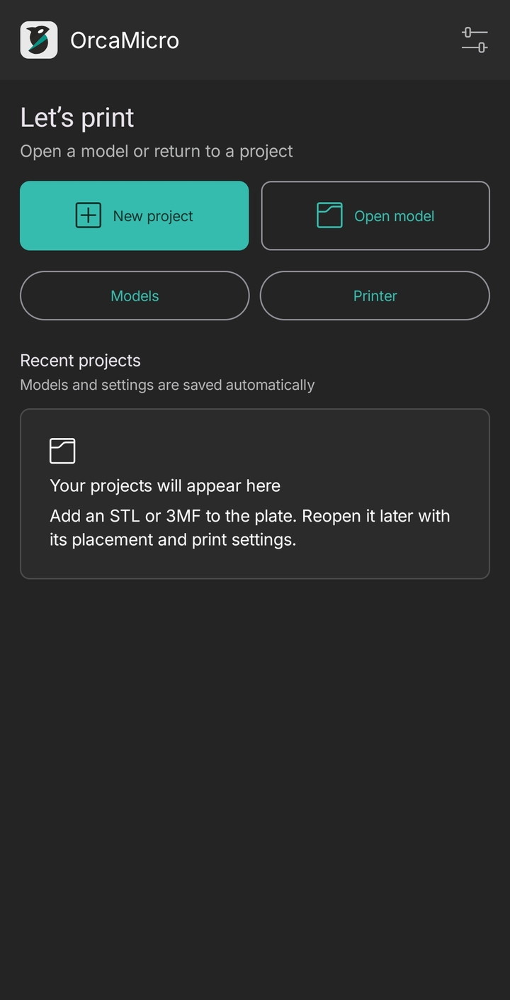
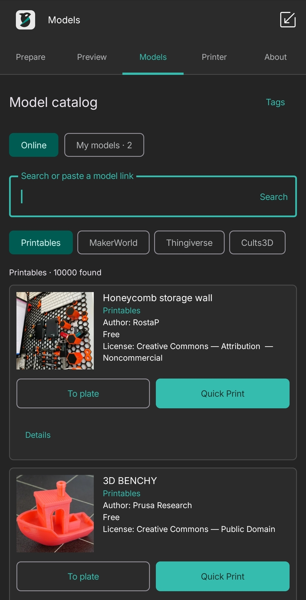

[English](README.md) · [Русский](README.ru.md)

<p align="center">
  
</p>

<h1 align="center">OrcaMicro</h1>

<p align="center">
  <b>Slice and design 3D prints on your phone, with OrcaSlicer's own engine.</b><br>
  No computer, no cloud: models are sliced and CAD parts are built on the device.
</p>

<p align="center">
  <a href="https://github.com/whoxllm/OrcaMicro/releases/latest"><b>Download the APK</b></a> ·
  <a href="#first-print">First print</a> ·
  <a href="#first-design">First design</a> ·
  <a href="https://github.com/whoxllm/OrcaMicro/issues">Report a problem</a>
</p>

<p align="center">
  Android 14+ · 64-bit ARM · OrcaSlicer 2.5.1 engine · about 50 MB · Beta
</p>

<p align="center">
  
  
</p>
<p align="center">
  
  
</p>

## Features

### Slice on the phone
- **OrcaSlicer 2.5.1's own engine,** not a cloud service: walls, infill, shells, skirt and brim,
  retraction, spiral vase, and normal and tree supports.
- **Over 1,100 printer profiles from 70 brands,** straight from OrcaSlicer. Import printer,
  filament and process presets from desktop OrcaSlicer, and save your own.
- **751 settings** with search, categories, favorites and a "changed only" filter, labelled and
  explained in English and Russian.
- **Layer preview** with a layer slider and line-type and travel filters. G-code includes thumbnails
  that Mainsail, Fluidd and OctoPrint show.
- **Slicing works fully offline.** The network is only used for model catalogs, printers and
  updates, and only when you use them.

### Design parts (parametric CAD)
- **OrcaSlicer's own Design engine** (Open CASCADE), driven by touch.
- **Sketch** lines, rectangles, circles and arcs on a plane or on a flat face, with constraints and
  dimensions.
- **Build** with extrude (new, add, cut), fillets, chamfers and holes. Undo and redo every step, and
  turn steps off or delete them in the feature tree.
- **Import STEP** files, either as a printable model or as a solid in a design.
- **To plate** sends the part to the plate for slicing. Designs are saved with the project and
  reopen editable.

### Place and prepare
- Open **STL, 3MF, STEP** or a model **ZIP**, also with "Open with" from a file manager.
- **Tap a model to select it, then drag it** to move it. Rotate, scale and center, with a check that
  it fits the build volume.
- **Projects** on the home screen: model, placement and settings are saved automatically.

### Print
- **Klipper/Moonraker and OctoPrint:** several saved printers, temperatures and charts, XYZ jog,
  homing, fans, and pause, resume and cancel. Mainsail or Fluidd open inside the app.
- **Uploading and starting a print are separate steps,** and the emergency **STOP** only fires after
  you type `Stop Klipper!`.
- **Quick Print:** catalog card → printer, filament and process → plate → slice → send.

### Find models
- Search **Printables, MakerWorld, Thingiverse and Cults3D** in the app, with author, source,
  price and license on every card. Downloads are cached for 7 days by default.

### App
- **In-app updates:** finds new releases, downloads in the background, checks the SHA-256 and the
  signature, then hands over to Android's installer.
- **English and Russian,** light and dark themes.

## Install

1. Open the [latest release](https://github.com/whoxllm/OrcaMicro/releases/latest) on your phone.
2. Download `OrcaMicro-arm64-vVERSION.apk` from **Assets**.
3. Open it and allow installs from that app when Android asks.

From then on, **About → ⚙ → App updates** finds new versions. Releases are always signed with the
same key, so updates keep your projects and presets. [Update details (RU)](docs/UPDATES.md)

Every change on `main` also refreshes the [**latest build**](https://github.com/whoxllm/OrcaMicro/releases/tag/latest)
pre-release: the newest APK that passed all tests on an Android emulator.

**Coming from redfaced97's OrcaSlicer for Android?** OrcaMicro installs as a separate app. Export
your profiles there and import them here.

## First print

1. Pick your printer. If it isn't listed, import your own OrcaSlicer JSON; imported presets appear
   under **My presets**.
2. **Prepare → Add** opens an STL, 3MF, STEP or ZIP. Check its placement, size and settings.
3. **Slice**, then check the layers under **Preview**, and save or send the G-code.
4. To print straight away, use **Quick Print** from a catalog card or **Prepare print** from the
   plate: choose printer and profiles, adjust layer height, infill and walls, **Slice for
   printing**, then **Send to printer**.
5. Check that the right filament is loaded and the plate is clear. **Upload** only stores the file
   on the printer; **Print** uploads it and starts after you confirm.

Changing the model, settings or printer clears the previous slice. STOP is an emergency shutdown,
and Klipper then needs `FIRMWARE_RESTART`; for normal control use Pause or Cancel.

## First design

1. Open the **Design** tab and tap **New sketch (XY)**.
2. Draw a rectangle, then give its sides **dimensions**.
3. **Extrude** it, for example by 10 mm.
4. Tap an edge and add a **fillet** or **chamfer**, or add a **hole** on a face.
5. Tap **To plate**, then slice as usual. The design stays editable in the project.

## Touch gestures

| Gesture | 3D view |
| --- | --- |
| One-finger drag | Orbit the camera |
| Two-finger drag | Pan |
| Pinch | Zoom |
| Tap the model | Select it (it turns lighter); tap again or tap empty space to deselect |
| Drag the selected model | Move it on the plate |

**Placement** (**Edit** on narrow screens) sets an exact position, rotation and scale.

## Import desktop presets

Import single JSON files, or bundle all your desktop presets on a computer:

```sh
python3 scripts/export-desktop-presets.py --resources /path/to/OrcaSlicer/resources
```

Copy `dist/private-presets/user-presets.json` to the phone, open a profile selector and press
**Import**. The script resolves inheritance and leaves out passwords and API keys.
[Profile guide (RU)](docs/PROFILES.md)

## Model catalog keys

Printables and MakerWorld search work without a key. Thingiverse needs your App Token, and Cults
needs your nickname and API key; set them under **Models → API**. Keys are encrypted with Android
Keystore and never included in exported profiles or backups. The Cults API has no file downloads,
so attach a file you already have. [Catalog guide (RU)](docs/MODELS.md)

## Current limits

- **One model, one plate and one material** at a time. 3MF objects are combined into one model.
- Not supported yet: multi-material and AMS, painting (color, supports, seams), modifiers, variable
  layer height, multiple plates, OBJ import, add-ons (OrcaSlicer plugins), and Bambu Lab printers.
- G-code is not guaranteed to match desktop OrcaSlicer for every model.
  [Compatibility (RU)](docs/COMPATIBILITY.md)

## How it is built

| Part | What it is |
|---|---|
| `app/` | The Android app: Kotlin, Jetpack Compose and OpenGL ES 3 |
| `core/` | Plain Kotlin: models, OrcaSlicer profiles and settings, G-code parsing, printer and catalog clients, updater. Unit-tested on any JVM |
| `native/` | Builds OrcaSlicer 2.5.1's `libslic3r` (including its CAD core and Open CASCADE) for Android, with a JNI bridge into `liborcamicro_engine.so` |

Slicing and CAD each run in their own Android process, so a crash in native code can't take the app
down, and cancelling a slice never touches an open design. Every change is built and tested on an
Android emulator by GitHub Actions, including real slicing and CAD tests. The original design is in
[docs/design.md](docs/design.md); building and testing are covered in [docs/BUILDING.md](docs/BUILDING.md) (Russian).

## Credits

| | |
| --- | --- |
| OrcaMicro: Android app, engine and CAD integration | whoxllm and contributors |
| Touch interface, projects, printer control, model catalogs, Quick Print, updater, Russian translation | [redfaced97](https://github.com/redfaced97), originally released as [OrcaSlicer for Android](https://github.com/redfaced97/OrcaSlicer-Android) |
| Beta testing | redfaced97 and an Ender 3 V3 SE (Klipper) |

Engine, CAD core, profiles, base translations and icons: [OrcaSlicer](https://github.com/OrcaSlicer/OrcaSlicer)
by SoftFever and contributors, based on Bambu Studio, PrusaSlicer and Slic3r. OrcaMicro is an
unofficial project and is not affiliated with the OrcaSlicer team.

License: **[AGPL-3.0](LICENSE)**. Open CASCADE Technology is under LGPL-2.1 with the Open CASCADE
exception, the SolveSpace solver under GPL-3.0, and Inter under [SIL OFL 1.1](third_party/Inter-OFL.txt).
Third-party notices are in [NOTICE](third_party/NOTICE.txt).
