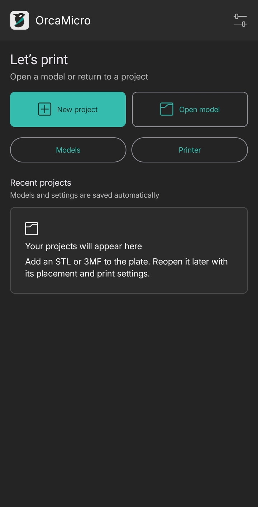
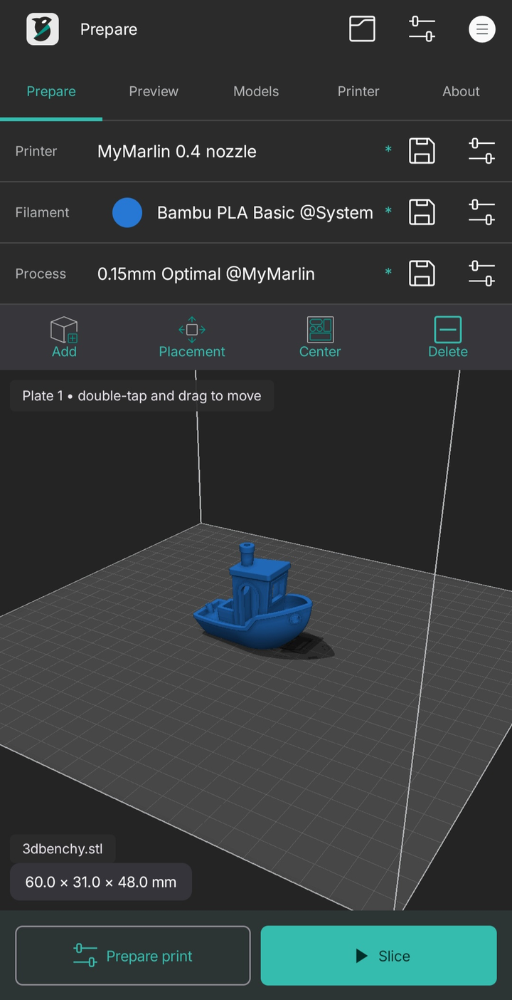
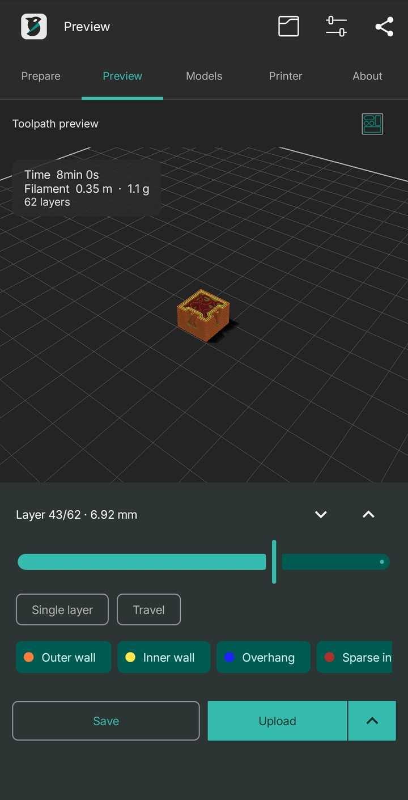
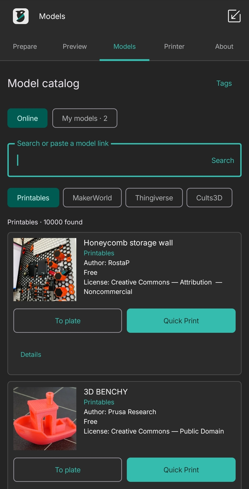

[English](README.md) · [Русский](README.ru.md)

<p align="center">
  
</p>

<h1 align="center">OrcaMicro</h1>

<p align="center">
  <b>Нарезка и проектирование деталей для 3D-печати прямо на телефоне, на движке OrcaSlicer.</b><br>
  Без компьютера и без облака: модели нарезаются и CAD-детали строятся на самом устройстве.
</p>

<p align="center">
  <a href="https://github.com/whoxllm/OrcaMicro/releases/latest"><b>Скачать APK</b></a> ·
  <a href="#первая-печать">Первая печать</a> ·
  <a href="#первая-деталь">Первая деталь</a> ·
  <a href="https://github.com/whoxllm/OrcaMicro/issues">Сообщить о проблеме</a>
</p>

<p align="center">
  Android 14+ · ARM64 · движок OrcaSlicer 2.5.1 · около 50 МБ · бета
</p>

<p align="center">
  
  
</p>
<p align="center">
  
  
</p>

## Возможности

### Нарезка на телефоне
- **Собственный движок OrcaSlicer 2.5.1,** а не облачный сервис: стенки, заполнение, сплошные
  слои, юбка и кайма, ретракт, режим вазы, обычные и древовидные поддержки.
- **Более 1100 профилей принтеров 70 производителей** прямо из OrcaSlicer. Импорт профилей
  принтера, пластика и процесса из настольной OrcaSlicer и сохранение своих пресетов.
- **751 параметр** с поиском, разделами, избранным и фильтром изменённых значений; подписи и
  подсказки на русском и английском.
- **Просмотр слоёв** с ползунком слоёв и фильтрами типов линий и перемещений. В G-code встраиваются
  миниатюры, которые показывают Mainsail, Fluidd и OctoPrint.
- **Цвет пластика** из палитры или по HEX, в том числе из импортированного профиля.
- **Нарезка работает без интернета.** Сеть нужна только каталогам моделей, принтеру и обновлениям,
  и только когда вы ими пользуетесь.

### Проектирование деталей (параметрический CAD)
- **Движок Design из OrcaSlicer** (Open CASCADE) с сенсорным управлением.
- **Эскизы** из линий, прямоугольников, окружностей и дуг на плоскости или на плоской грани, с
  ограничениями и размерами.
- **Построение:** выдавливание (новое тело, добавить, вырезать), скругления, фаски и отверстия.
  Отмена и повтор каждого шага; в дереве построений шаги можно отключить или удалить.
- **Импорт STEP** как модели для печати или как твёрдого тела в проекте CAD.
- Кнопка **«На стол»** отправляет деталь на стол для нарезки. Модель сохраняется в проекте и
  открывается снова редактируемой.

### Размещение и подготовка
- Файлы **STL, 3MF, STEP** и **ZIP** с моделями, в том числе через «Открыть с помощью».
- **Нажмите на модель, чтобы выбрать её, и перетащите.** Поворот, масштаб, центрирование и проверка,
  помещается ли модель в область печати.
- **Проекты** на главном экране: модель, положение и настройки сохраняются автоматически.

### Печать
- **Klipper/Moonraker и OctoPrint:** несколько принтеров, температуры и графики, перемещение XYZ,
  парковка, обдув, пауза, продолжение и отмена. Mainsail или Fluidd открываются внутри приложения.
- **Загрузка файла и запуск печати — отдельные действия,** а аварийный **STOP** срабатывает только
  после точного ввода `Stop Klipper!`.
- **Quick Print:** карточка модели → принтер, пластик и процесс → стол → нарезка → отправка.

### Поиск моделей
- Поиск в **Printables, MakerWorld, Thingiverse и Cults3D** прямо в приложении; в каждой карточке
  автор, источник, цена и лицензия. Ссылку на модель можно вставить прямо в поиск. Скачанные
  файлы хранятся 7 дней (срок настраивается).

### Приложение
- **Обновления внутри приложения:** поиск новых версий, фоновая загрузка, проверка SHA-256 и
  подписи, передача системному установщику Android.
- **Русский и английский,** светлая и тёмная темы; графические настройки (SSAO, тени, разрешение
  сцены) — в **«О программе» → ⚙ → «Графика»**.

## Установка

1. Откройте [последний релиз](https://github.com/whoxllm/OrcaMicro/releases/latest) на телефоне.
2. В **Assets** скачайте `OrcaMicro-arm64-vВЕРСИЯ.apk`.
3. Откройте файл и разрешите установку из этого приложения, когда Android спросит.

Дальше новые версии находятся в **«О программе» → ⚙ → «Обновления приложения»**. Релизы всегда
подписаны одним ключом, поэтому обновление сохраняет проекты и профили.
[Подробнее об обновлениях](docs/UPDATES.md)

Каждое изменение в `main` также обновляет пре-релиз [**latest**](https://github.com/whoxllm/OrcaMicro/releases/tag/latest):
самую новую сборку, прошедшую все тесты на эмуляторе Android.

**Переходите с OrcaSlicer для Android от redfaced97?** OrcaMicro устанавливается отдельным
приложением. Экспортируйте профили там и импортируйте их здесь.

## Первая печать

1. Выберите принтер. Если его нет в списке, импортируйте свой JSON из OrcaSlicer; импортированные
   профили находятся в разделе **«Мои профили»**.
2. **«Подготовка» → «Добавить»** открывает STL, 3MF, STEP или ZIP. Проверьте положение, размер и
   настройки.
3. Нажмите **«Нарезать»**, проверьте слои на вкладке **«Просмотр»** и сохраните или отправьте
   G-code.
4. Чтобы сразу печатать, используйте **Quick Print** из карточки каталога или **«К печати»** со
   стола: выберите принтер и профили, при необходимости измените высоту слоя, заполнение и стенки,
   нажмите **«Нарезать для печати»**, затем **«Отправить на печать»**.
5. Убедитесь, что заправлен нужный пластик и стол свободен. **«Загрузить»** только сохраняет файл
   на принтере; **«Напечатать»** загружает его и запускает печать после подтверждения.

Изменение модели, настроек или принтера сбрасывает прошлую нарезку. STOP — аварийная остановка,
после неё Klipper требует `FIRMWARE_RESTART`; для обычного управления используйте паузу или отмену.

## Первая деталь

1. Откройте вкладку **«Дизайн»** и нажмите **«Новый эскиз (XY)»**.
2. Нарисуйте прямоугольник и задайте **размеры** его сторон.
3. **Выдавите** его, например на 10 мм.
4. Выберите ребро и добавьте **скругление** или **фаску**, или добавьте **отверстие** на грани.
5. Нажмите **«На стол»** и нарежьте как обычно. Деталь остаётся редактируемой в проекте.

## Жесты

| Жест | 3D-вид |
| --- | --- |
| Свайп одним пальцем | Вращение камеры |
| Движение двумя пальцами | Перемещение камеры |
| Щипок | Приближение и отдаление |
| Нажатие на модель | Выбор (модель становится светлее); повторное нажатие или нажатие в пустое место снимает выбор |
| Перетаскивание выбранной модели | Перемещение по столу |

Для точного положения, поворота и масштаба используйте **«Положение»** (на узком экране —
**«Правка»**).

## Перенос настроек с ПК

Можно импортировать отдельные JSON-профили или собрать все профили с компьютера скриптом:

```sh
python3 scripts/export-desktop-presets.py --resources /path/to/OrcaSlicer/resources
```

Скопируйте `dist/private-presets/user-presets.json` на телефон, откройте выбор профиля и нажмите
**«Импортировать»**. Скрипт разрешает наследование и не включает пароли и API-ключи.
[Подробная инструкция](docs/PROFILES.md)

## Ключи каталогов

Поиск Printables и MakerWorld работает без ключа. Thingiverse требует App Token, Cults — ник и
API-ключ; их задают в **«Модели» → API**. Ключи шифруются Android Keystore и не попадают в
экспорт профилей и резервные копии. Cults API не отдаёт файлы, поэтому к карточке можно
прикрепить свой файл. [Каталоги и доступ к API](docs/MODELS.md)

## Текущие ограничения

- **Одна модель, один стол и один материал** одновременно. Объекты 3MF объединяются в одну модель.
- Пока не поддерживаются: многоматериальная печать и AMS, покраска (цвет, поддержки, швы),
  модификаторы, переменная высота слоя, несколько столов, импорт OBJ, дополнения (плагины
  OrcaSlicer) и принтеры Bambu Lab.
- Совпадение G-code с настольной OrcaSlicer для всех моделей не гарантируется.
  [Совместимость](docs/COMPATIBILITY.md)

## Как устроено

| Часть | Что это |
|---|---|
| `app/` | Приложение Android: Kotlin, Jetpack Compose и OpenGL ES 3 |
| `core/` | Чистый Kotlin: модели, профили и настройки OrcaSlicer, разбор G-code, клиенты принтеров и каталогов, обновления. Тесты на любой JVM |
| `native/` | Сборка `libslic3r` из OrcaSlicer 2.5.1 (вместе с ядром CAD и Open CASCADE) для Android и JNI-мост в `liborcamicro_engine.so` |

Нарезка и CAD работают в отдельных процессах Android, поэтому сбой в нативном коде не закрывает
приложение, а отмена нарезки не затрагивает открытую деталь. Каждое изменение собирается и
проверяется на эмуляторе Android в GitHub Actions, включая настоящую нарезку и тесты CAD.
[Сборка и тесты](docs/BUILDING.md) · [Инструкция по работе с приложением](docs/USAGE.md)

## Авторы

| | |
| --- | --- |
| OrcaMicro: Android-приложение, интеграция движка и CAD | whoxllm и участники проекта |
| Сенсорный интерфейс, проекты, пульт принтера, каталоги моделей, Quick Print, обновления, русский перевод | [redfaced97](https://github.com/redfaced97); изначально выпущено как [OrcaSlicer для Android](https://github.com/redfaced97/OrcaSlicer-Android) |
| Бета-тестирование | redfaced97 и Ender 3 V3 SE (Klipper) |

Движок, ядро CAD, профили, основа переводов и иконки — [OrcaSlicer](https://github.com/OrcaSlicer/OrcaSlicer),
SoftFever и участники, на основе Bambu Studio, PrusaSlicer и Slic3r. OrcaMicro — неофициальный
проект, не связанный с командой OrcaSlicer.

Лицензия проекта — **[AGPL-3.0](LICENSE)**. Open CASCADE Technology распространяется по LGPL-2.1 с
исключением Open CASCADE, решатель SolveSpace — по GPL-3.0, шрифт Inter — по
[SIL OFL 1.1](third_party/Inter-OFL.txt). Уведомления о сторонних компонентах — в
[NOTICE](third_party/NOTICE.txt).
