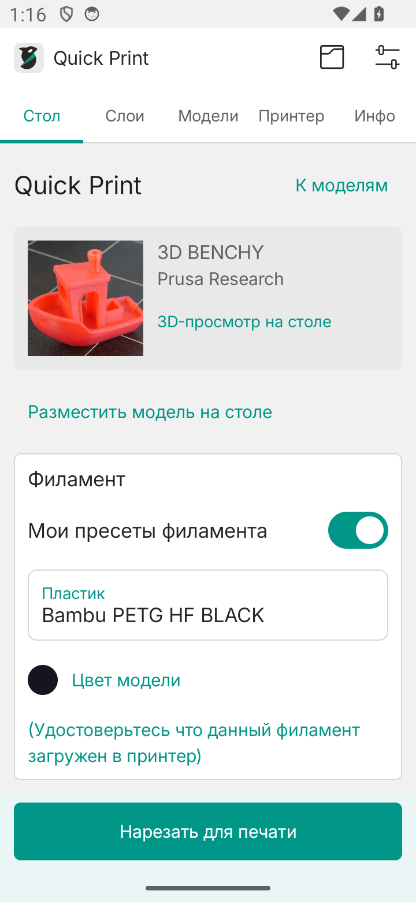
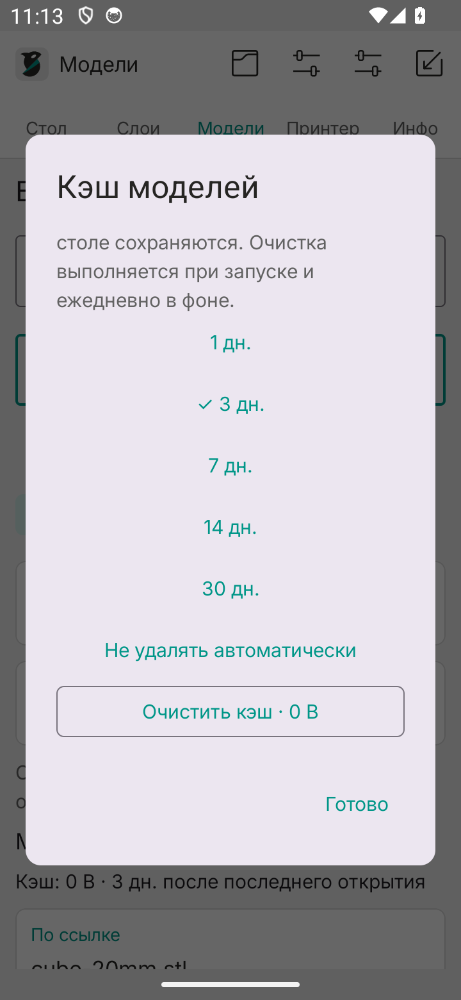

# Нативный каталог, Quick Print и кэш

[← README](../README.ru.md) · [English](../README.md)

## Поиск по запросу и тегам

1. Откройте **«Модели» → «В интернете»**. По умолчанию загружаются популярные модели Printables.
2. Введите запрос, например `phone holder`, и при необходимости раскройте **«Теги»** и укажите их через запятую: `phone, stand`.
3. Выберите Printables, MakerWorld, Thingiverse или Cults3D и нажмите **«Найти»** в поле запроса. Приложение обращается к JSON API и строит нативный список; сайт не открывается.
4. **«Загрузить ещё»** добавляет следующую страницу. Ошибки подключения и доступа показываются рядом с результатами; можно повторить запрос или открыть **«О программе» → ⚙ → «Каталоги и кэш моделей» → «Настройки API»**.

Теги добавляются к поисковому запросу площадки. Для Thingiverse один тег без запроса использует `/tags/<tag>/things`. Дополнительно результаты фильтруются по полному совпадению всех указанных тегов из ответа API; это может уменьшить число видимых карточек на странице.

В **«Мои модели»** поиск выполняется локально по названию, файлу, автору, источнику и тегам; интернет не нужен для файла, оставшегося в кэше. Кнопка **«Теги»** меняет теги карточки, быстрые фильтры показывают сохранённые теги.

## Карточки и Quick Print

Фото расположено слева, название, площадка, автор, платность и лицензия — справа. Цена и лицензия — отдельные сведения: бесплатный файл может иметь ограничения коммерческого использования. Когда API не сообщает автора, лицензию или цену, приложение явно показывает отсутствие данных. В поиске MakerWorld цена часто отсутствует; карточка уточняется при запросе подробностей.

- **На стол** — получить доступные файлы через API, выбрать файл, скачать и разместить геометрию для поворота, масштаба и перемещения.
- **Quick Print** — получить файл и открыть подготовку: фото, 3D-стол, подключённый принтер и профили принтера, пластика и процесса. Переключатель **«Мои пресеты филамента»** оставляет в выборе только импортированные пластики; можно открыть общий список.
- На встроенном столе двойной тап с удержанием перемещает модель. **«Изменить»** открывает полный стол с точными координатами, поворотом и масштабом. **«В Quick Print»** или системная «Назад» возвращают к подготовке.
- Можно выбрать цвет, высоту слоя, заполнение и число стенок. **«Все параметры печати»** открывает полный редактор.
- **«Нарезать для печати»** выполняет локальную нарезку и возвращает в Quick Print. После проверки слоёв **«Отправить на печать»** открывает подтверждение. Загрузка G-code и запуск печати остаются отдельными действиями. [Отправка на принтер](USAGE.md#подготовка-и-отправка-на-печать).
- **Подробнее** показывает полную лицензию, доступные данные и адрес источника в нативном диалоге.

Если API не разрешает получить файл, диалог объясняет причину и предлагает **«Прикрепить свой STL / ZIP / 3MF»**. Файл сохраняется с автором, лицензией и источником этой карточки. Оплата и чужие ограничения доступа не обходятся.

Компоновка Quick Print вдохновлена [экраном Prepare to Print в Bambu Handy](https://cms.bblmw.com/7print_from_Bambu_Handy5_de3f92a81e.jpg). Функции принтера определяются выбранными профилями и Klipper; неподдерживаемые Bambu-опции не добавляются декоративными переключателями.

## Доступ к API

Настройки ключей API находятся в **«О программе» → ⚙ → «Каталоги и кэш моделей» → «Настройки API»**.

| Площадка | Поиск и карточки | Получение файла |
| --- | --- | --- |
| Printables | GraphQL `searchPrints2` без ключа | `print.stls` → `getDownloadLink`; открытые STL доступны анонимно. Для ограниченных файлов можно указать собственный session cookie. |
| MakerWorld | Bambu JSON API `select/design2` и популярные модели `select/design/nav` без ключа | Подробности модели → доступные исходники или 3MF профиля. API может потребовать личный Bambu access token. |
| Thingiverse | REST API с собственным **App Token** из Thingiverse Developers | Список `/things/<id>/files`, поддержанные STL/3MF/ZIP. |
| Cults3D | GraphQL с HTTP Basic Auth: ник + личный **API key** | Официальный API **не предоставляет файлы моделей**. Прикрепите полученный у автора или ранее приобретённый файл. |

Ключи и сессии шифруются AES-GCM ключом Android Keystore и хранятся в `noBackupFilesDir`, отдельно от профилей и `state.json`. Они не попадают в экспорт, Android backup, исходники или релиз. Вводятся токены/ключи; пароли аккаунтов приложение не запрашивает. Авторизация отправляется только своему API-хосту, включая перенаправления файлов; CDN других площадок не получает чужие ключи. Для удаления сохранённого ключа очистите соответствующее поле и сохраните.

API площадок могут менять схему, требовать авторизацию или временно ограничивать запросы. Проверены живые анонимные поиск Printables/MakerWorld, подробности модели и получение STL Printables; подключение к личным аккаунтам Thingiverse/Cults и защищённые загрузки требуют действительных ключей пользователя. Контракты адаптеров и изоляция ключей покрыты тестами с ответами API.

Источники: [GraphQL Printables](https://api.printables.com/graphql/), [Bambu search API](https://api.bambulab.com/v1/search-service/select/design2?keyword=benchy&limit=1), [Thingiverse Developers](https://www.thingiverse.com/developers), [Cults API](https://cults3d.com/en/pages/graphql), [официальные примеры Cults](https://gist.github.com/sunny/07db54478ac030bd277c19cfe734648b).

## Ссылки

Вставьте адрес конкретной модели в поле поиска и нажмите **«Открыть»** в поле запроса. Поддерживаются ссылки четырёх площадок, прямые HTTPS-ссылки на STL/ZIP/3MF и `orcaslicer://`. Ссылкой также можно поделиться через меню Android.

```text
https://www.printables.com/model/3161-3d-benchy
https://makerworld.com/en/models/40146-benchy-bambu-pla-basic
https://raw.githubusercontent.com/whoxllm/OrcaMicro/main/samples/cube-20mm.stl
orcaslicer://open?file=https%3A%2F%2Fexample.com%2Fcube.stl
orcaslicer://open?url=https%3A%2F%2Fwww.printables.com%2Fmodel%2F3161
```

`file` — прямая HTTPS-загрузка; `url` — конкретная модель площадки, открываемая через API. Необязательные `name` и `source` задают имя файла и источник. Значения кодируются как URL query. Команды управления принтером через ссылку не выполняются.

## Форматы

В ZIP с несколькими деталями сначала выберите нужную. 3MF импортируется как геометрия с единицами, компонентами и трансформациями. Объекты объединяются; настройки автора, покраска, AMS и распределение по отдельным столам не переносятся. Используются ваши профили печати.

Размер файла ограничен 96 МБ. У 3MF также ограничены распакованный XML, глубина ссылок, число компонентов и треугольников.

## Кэш

**«О программе» → ⚙ → «Каталоги и кэш моделей»**.

Файлы хранятся **7 дней после последнего открытия**. Можно выбрать 1, 3, 7, 14, 30 дней или отключить автоудаление. Очистка при старте, открытии библиотеки и ежедневно через Android JobScheduler; система может отложить фоновый запуск.

**«Очистить кэш»** удаляет файлы сразу, оставляя карточки, теги и источники. Текущая модель на столе хранится отдельно. Удалённый файл можно получить снова через API или прикрепить заново. **«Удалить»** в «Мои модели» убирает карточку вместе с её файлом. Миниатюры имеют отдельный ограниченный кэш в памяти 4 МБ.

<p align="center">
  
  
</p>
